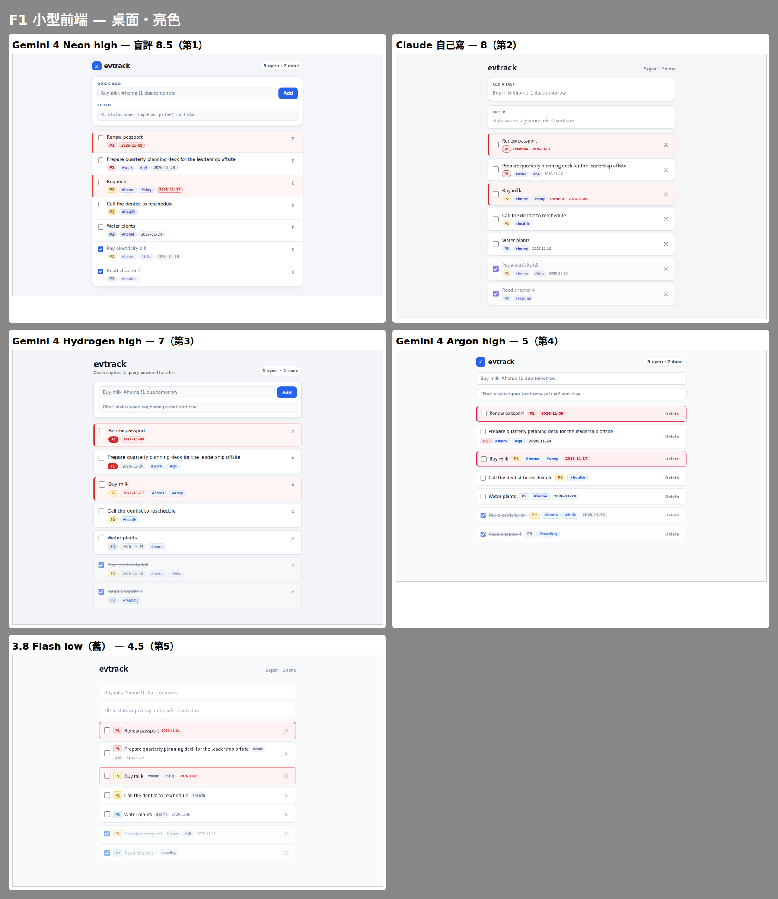

# Claude × Antigravity 協作

**讓 Claude Code 當架構師、Gemini 當工程師：Claude 只寫規格和驗收測試，實作交給 Google Antigravity 的 Gemini，藉此省下 Claude 額度，而且品質不降。**

這個 repo 有兩樣東西：
1. **一個可以直接安裝的 Claude Code skill**（`skill/`），裝好後 Claude 遇到適合的工作會自動委派。
2. **它有效的證據**：12 個任務、20 多個對照組、hidden tests、匿名盲審，全部數據和重現工具都在這裡。

> **English summary** — A Claude Code skill that delegates spec'd, test-checkable implementation work to Gemini via
> Google Antigravity's `agy` CLI. Claude writes a short spec plus 2–4 golden tests, a script runs Gemini behind an
> automatic test gate (retries, self-audit, protected tests), and Claude reads only a ~10-line report. Measured on
> backend batches: Claude tokens drop to **55–68%** of doing it alone, hidden tests still pass, and blind code review
> scores the delegated code *higher* (Gemini 4: 7–9/10 vs 5.5). Naively outsourcing and reviewing the diff cost **188%**.

---

## 結論

| | 數字 |
|---|---|
| Claude token 用量 | 自己寫的 **55–68%**（3 組實驗、2 套任務） |
| 品質 | hidden tests 與 Claude 自己寫相同；匿名盲審中委派產出的程式碼分數**更高**（7–9 分，Claude 自己寫 5.5） |
| Gemini 端代價 | 每批 4–6 個任務約用 **2–5% 的 5 小時額度**，等 **5–11 分鐘** |
| 反例 | 丟給 Gemini 後由 Claude 讀 diff 審查：**188%**，比自己寫還貴 |

## 為什麼「直接丟給 Gemini」反而更貴

Claude 的花費大約是 **回合數 × context 大小**：每次呼叫工具都要重讀整個 context，而讀進來的程式碼之後每一回合都會再被讀一次。
所以讓 Claude 審 Gemini 寫的 diff，就是把整份程式碼搬進 Claude 的 context，省下的全部吃回去。

這個 skill 的核心原則是：**Claude 不讀 Gemini 的程式碼。** 品質靠自動化的閘門把關，而不是靠 Claude 審查。

## 運作方式

```
Claude（貴：只做判斷）               delegate.py（不耗 Claude）               Gemini（便宜：做苦工）
─────────────────────               ──────────────────────────               ─────────────────────
1. plan_split：值得委派嗎？
2. 寫短規格 + 每任務 2–4 個 golden 測試
3. 背景啟動 delegate.py，結束回合 ──► 檢查額度、挑模型 ──────────────────────► 實作，並自己寫完整測試
                                     跑驗收測試，失敗就把錯誤回餵重試  ◄──────► 修正
                                     golden 測試被改 → 自動還原
                                     另開一個 session 做稽核  ───────────────► 稽核，有問題就修
4. 讀約 10 行的報告  ◄────────────── 通過與否、改了哪些檔案、新的公開介面、額度用量
```

模型不寫死，依 `agy models` 和剩餘額度自動挑選。目前（Gemini 4）的預設：
- **後端**：Orchestrator（Argon 或 Neon 規劃、Hydrogen 執行）。在子代理裡改用 `--fast`（Hydrogen 平行）。
- **稽核**：Hydrogen high。

## 品質：匿名盲審

同一批後端任務（查詢語法、CLI、HTTP API），由 Claude 子代理匿名審查各組程式碼，只計算**實際跑得出來**的 bug：

| 誰寫的 | 盲審分數（1–10） |
|---|---|
| Claude 自己寫（Sonnet） | 5.5 |
| Gemini 3.8 Flash high | 6 |
| Gemini 4 Hydrogen high | 7 |
| Gemini 4 Argon high | 7.5 |
| Orchestrator（Neon 規劃 + Hydrogen） | 8 |
| **Orchestrator（Argon 規劃 + Hydrogen）** | **8.5** |
| Gemini 4 Neon high | 9 |

所有組的 hidden tests 都是 50/50。分數差距來自 hidden tests 沒涵蓋的地方，例如型別檢查、錯誤輸入、HTTP 細節。
一個可能的原因：委派流程要求 Gemini 另外寫完整測試並經過一輪稽核，Claude 自己寫時沒有這一步。

**前端**：3.8 Flash 獨自做的 UI 兩次盲評都墊底。Gemini 4 Neon 獨自做的小型 UI 得 8.5，與 Claude 的 8 打平：



其他畫面（暗色、手機、錯誤狀態、空狀態）在 [`data/screenshots/compare_gemini4/`](data/screenshots/compare_gemini4/)。

## 什麼時候該用

| 適合委派 ✅ | Claude 自己做 ❌ |
|---|---|
| 規格寫得清楚、能用自動測試驗收的工作 | 需要架構、安全或設計判斷的工作 |
| 後端邏輯、parser、CLI、API、資料轉換、bug 修正、補測試 | 單項少於 40 行的小改動 |
| 一批合計約 300 行以上（每次呼叫 Gemini 有約 25k 的固定開銷） | 整批太小 |
| 大型前端的 JS 邏輯層（Claude 先做設計系統） | 小型 UI 的視覺設計（可試讓 Neon 先做，Claude 只看截圖） |

不用自己判斷：skill 內建的 `plan_split.py` 會依實測模型回答「委派還是自己做」。

## 安裝

需要：Claude Code、已登入的 Antigravity `agy` CLI、Python 3.10+、git。

```bash
git clone https://github.com/jasonxp516/claude-antigravity-cowork
cp -r claude-antigravity-cowork/skill/agy-cowork ~/.claude/skills/
cat claude-antigravity-cowork/skill/CLAUDE.md.example >> ~/.claude/CLAUDE.md   # 讓 Claude 自動判斷何時委派
python3 ~/.claude/skills/agy-cowork/tools/agy_quota.py                         # 確認 agy 可用、查看額度（不耗額度）
```

裝好之後照常請 Claude 寫程式即可，Claude 會自己判斷要不要委派。手動使用、參數、前端分工流程見 [docs/USAGE.md](docs/USAGE.md)。
agy 額度用完時，Claude 會停止委派並告訴你，換一個帳號就能繼續。

## 怎麼驗證的

- **測試專案**：自建的 Python 套件，12 個任務（後端 10 個、前端 2 個）。每個任務都有 **hidden tests**，寫程式的一方和指揮的 Claude 都看不到。
- **對照組**：每組是一個獨立的 Claude Sonnet 子代理，在自己的工作目錄完成同一批任務。Claude token 從對話紀錄逐則加總。基準組由 Claude 自己寫。
- **品質**：hidden tests、依規格寫的邊界探針，以及匿名盲審（程式碼由 Sonnet 實際重現 bug，畫面由 Opus 看截圖）。
- **Gemini 成本**：每批前後讀取 agy 的 `/usage`（讀取本身不耗額度）。
- **迭代**：skill 從 v1（179%，比自己寫還貴）一路改到 v9，每次修改都由數據觸發，見 [docs/CHANGELOG.md](docs/CHANGELOG.md)。

## 限制

- 每個對照組只跑 1–2 次。Claude 自己寫的基準本身就有約 ±10% 的波動（同一批任務兩次分別是 112.7k、136.7k）。
- 盲審每組只評一次，評審本身約有 ±0.7 分的誤差。
- 量測都在 Claude **子代理**中進行。主對話的快取較長（1 小時），理論上更划算，但沒有直接量測。
- 只測過 Python 後端和網頁前端。
- 合約寫錯，錯誤就會被照做：有一組因為 Claude 自己的 golden 測試寫錯，hidden tests 少過 1 題。skill 已加入「衝突時先懷疑自己的測試」這條規則。

## 文件

| 文件 | 回答什麼問題 |
|---|---|
| [docs/RESULTS.md](docs/RESULTS.md) | 省多少？品質如何？選哪個模型？前端行不行？子代理和主對話差在哪？ |
| [docs/USAGE.md](docs/USAGE.md) | 怎麼用、參數、模型角色、前端分工流程 |
| [docs/METHODOLOGY.md](docs/METHODOLOGY.md) | 怎麼量、怎麼驗證、如何重現 |
| [docs/CHANGELOG.md](docs/CHANGELOG.md) | skill 從 v1 到 v9 每版改了什麼、為什麼 |
| [docs/lab-notebook.md](docs/lab-notebook.md) | 依時間順序的原始實驗筆記 |
| [data/](data/) | 所有原始數據與截圖 |

```
skill/        可安裝的 skill（SKILL.md、工具、模型設定、前端規則）與 CLAUDE.md 範例
docs/         說明文件
experiment/   重現用：測試專案、12 個任務與 hidden tests、量測工具、各版 skill
data/         原始數據：委派紀錄、額度紀錄、盲審對照表、評審原文、截圖
```

授權：MIT
