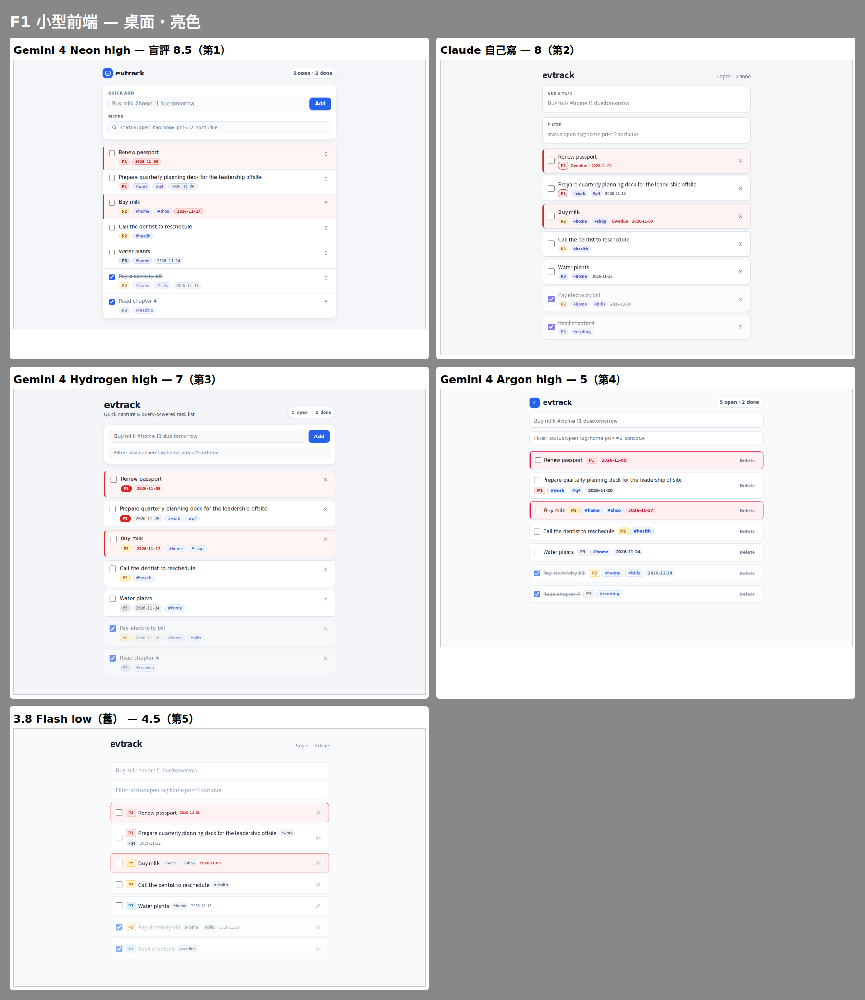

# 實驗結果

依問題整理。量法見 [METHODOLOGY.md](METHODOLOGY.md)，時間順序的原始筆記見 [lab-notebook.md](lab-notebook.md)。

**名詞**
- **IET**：Claude 的加權 token = input + 1.25×cache write + 0.1×cache read + 5×output（依 API 相對價格換算成「等效 input token」）。
- **對照組（arm）**：一個 Claude Sonnet 子代理在獨立目錄完成同一批任務。
- **hidden tests**：寫程式的一方與指揮的 Claude 都看不到的測試。
- **T1–T6**：儲存層、parser、查詢語法、CLI、WSGI API、bug fix，共 50 個 hidden tests。
- **T7–T10**：CSV/iCal 匯入匯出、undo/redo、循環任務、統計報表，共 17 個 hidden tests。

---

## 1. 能省多少 Claude token？

### T1–T6
| arm | 做法 | Claude IET | 相對自己寫 | hidden |
|---|---|---|---|---|
| A | Claude 自己寫 | 115.7k | 100% | 50/50 |
| B | 無腦外包：丟給 Gemini，Claude 讀完整 diff 審查 | 217.0k | **188%** | 50/50 |
| C1 | skill v1：Claude 寫完整驗收測試 | 207.5k | 179% | 50/50 |
| C2 | v2：只寫 2–4 個 golden asserts | 155.2k | 134% | 50/50 |
| C3 | v3：平行 worktree、背景執行不輪詢 | 130.6k | 113% | 50/50 |
| **C6** | **v4：3.8 Flash low，總等待 <5 分鐘** | **78.9k** | **68%** | 50/50 |

### T7–T10
| arm | 做法 | Claude IET | 相對自己寫* | hidden |
|---|---|---|---|---|
| A2 | Claude 自己寫 | 112.7k | 100% | 17/17 |
| C10 | v9，分工判斷說「自己做」→ Claude 自己寫 | 136.7k | （基準） | 17/17 |
| C4 | v3 | 105.7k | 77–94% | 17/17 |
| **C5** | **v4：3.8 Flash low** | **69.9k** | **51–62%** | 17/17 |
| C7 | v6 | 89.7k | 66–80% | 17/17 |
| C9 | v7：Flash high，子代理等 13 分鐘 | 142.1k | 104–126% | 17/17 |
| C8 | v7＋每 4.5 分鐘喚醒保溫快取 | 172.7k | 126–153% | 17/17 |
| **C12** | **v9：Gemini 4 Hydrogen，`--fast`（等 6.5 分鐘）** | **75.7k** | **55–67%** | 16/17† |
| C11 | v9：Orchestrator（等 11 分鐘） | 124.4k | 91–110% | 17/17 |

\* T7–T10 有兩個「Claude 自己寫」的基準（112.7k 和 136.7k），所以用區間表示。
† 失敗是 Claude 自己寫錯 golden 測試（redo 是否跨實例保存），見第 2.4 節。

**結論**
- 做對的時候，Claude 用量是自己寫的 **55–68%**。
- 決定成敗的兩件事：**Claude 不讀 Gemini 的程式碼**（B 是 188%），以及 **子代理裡不要等超過約 5–7 分鐘**（C9、C11 把省下的吃光）。

### 為什麼會省：分工模型
```
Claude 節省 ≈ 12 × 被卸載的 output tokens − 固定成本 35k
被卸載的 output ≈ 行數 × 每行 token（後端 20、前端 34）× 可卸載比例（後端 0.7、前端邏輯 0.25、視覺 0）
```
- 乘數是 12，而不是 output 價格的 5，因為 Claude 自己寫的程式碼之後每回合都會被重讀。
- 固定成本 35k 來自：讀 skill、寫規格與 golden 測試、讀報告。
- 驗算：

  | 情境 | 預測 | 實測 |
  |---|---|---|
  | 後端 470 行 | +44k | +37–43k |
  | T7–T10 在子代理 + `--fast` | +37k | +37–61k |
  | 大型 UI 分工 | +13k | +16k |
  | 小型 UI | 負值 | −55k |

- 門檻：同一批可卸載的後端程式約 **300 行**以上才值得委派。這套模型實作在 `plan_split.py`。

---

## 2. 品質有沒有掉？

### 2.1 hidden tests
委派的每一組 hidden tests 都和 Claude 自己寫一樣全過，唯一例外是 C12（原因見 2.4）。
hidden tests 對所有組都滿分，分不出高下，所以另外做了 2.2–2.3。

### 2.2 程式碼盲審（Gemini 4，T3–T5：查詢語法、CLI、HTTP API）
Sonnet 審匿名程式碼，**只計實際重現的 bug**。對照表在 `data/blind_map_b6.json`。

| 誰寫的 | 盲審 | 重現到的問題 |
|---|---|---|
| Claude 自己寫（Sonnet） | 5.5 | CLI 用法錯誤時丟 `SystemExit`、沒有寫到 `out`；PATCH 接受 `true` 當 priority；錯誤訊息直接是 Python 原文 |
| 3.8 Flash high | 6 | PATCH 接受 `true`/`2.0`；結尾斜線沒有回 404；非數字的 `CONTENT_LENGTH` 被忽略 |
| Hydrogen high | 7 | PATCH 接受 `2.0`；把阿拉伯–印度數字當成數字 |
| Argon high | 7.5 | PATCH 接受 `2.0` |
| Orchestrator（Neon） | 8 | PATCH 接受 `2.0` |
| Orchestrator（Argon） | 8.5 | 空的 `CONTENT_LENGTH` 回 400 |
| Neon high | 9 | 無（只有六組共通的問題） |

六組共通的問題：PATCH 收到極深的巢狀 JSON（10 萬層 `[`）會丟 `RecursionError`。

### 2.3 邊界探針
依規格寫的自動檢查，包含先前盲審找到的 bug 類型：T1–T6 有 35 項（`edge_probe_t1_6.py`），T7–T10 有 22 項（`edge_probe_t7_10.py`）。
其中 agenda 一項規格本身有歧義，各組做法不同，不能當成錯誤。

| | T1–T6 | T7–T10 |
|---|---|---|
| Claude 自己寫 | 33/35 | 21/22（C10） |
| 3.8 Flash low | 33/35 | 20/22（tag 大小寫重複計數） |
| 3.8 Flash high | 35/35 | 20/22（`splitlines()` 吃掉 U+2028） |
| Hydrogen high | 33/35 | 21/22 |
| Neon high | 34/35 | 21/22 |
| Argon high | 34/35 | 21/22 |
| Orchestrator（Neon / Argon） | 34 / **35** | –（C11：**22/22**） |

T1–T6 最常見的兩個失敗是：CLI 的 `add fix -v flag` 會失敗，以及 `update(due="字串")` 丟出錯誤型別的例外。**Claude 自己寫也有這兩個**，所以它們比較像是規格沒寫清楚，而不是模型能力的問題。

### 2.4 失敗案例：合約寫錯
C12 中，Claude 寫的 golden 測試斷言「重新開啟後 redo 應該失敗」，但規格要求 undo/redo 要能跨實例使用。
Gemini 的稽核其實指出了這個問題，但 worker 以 golden 測試為準，最後 hidden tests 少過 1 題。
→ skill 新增規則：**稽核或 worker 回報的衝突若和自己的 golden 測試矛盾，先懷疑自己的測試。**

### 2.5 Gemini 的自我稽核抓得到 bug 嗎？
把 3.8 Flash low 寫的 T1–T6（含 2 個已知 bug）交給各模型稽核（`audit_probe.py`，原文在 `data/gemini4_audit_probe.md`）：

| 稽核模型 | 已知 bug 抓到幾個 |
|---|---|
| Hydrogen high | **1/2**，另外回報 4 項邊角問題 |
| Neon high / Argon high / 3.8 Flash high | 0/2（回報 `NO_ISSUES`） |

→ 稽核改用 Hydrogen high，但重要模組仍建議由 Claude 抽查一次。

---

## 3. 該用哪個 Gemini 模型？

### 3.1 Gemini 4（後端 T1–T6，同一起點，只換模型）
| 模型 | hidden | 探針 | 盲審 | 耗時 | Gemini 5h 額度 | 其他額度 |
|---|---|---|---|---|---|---|
| 3.8 Flash low | 50/50 | 33 | – | ~5 分 | 2.9% | – |
| 3.8 Flash high | 50/50 | 35 | 6 | ~20 分 | 15.2% | – |
| Hydrogen high | 50/50 | 33 | 7 | **4.7 分** | 4.9% | – |
| Neon high | 50/50 | 34 | **9** | 9.9 分 | 12.7% | – |
| Argon high | 50/50 | 34 | 7.5 | 10.3 分 | – | Argon 週額度 14.8% |
| Orchestrator（Neon） | 50/50 | 34 | 8 | 8.7 分 | ~4% | – |
| **Orchestrator（Argon）** | 50/50 | **35** | **8.5** | 8.7 分 | **2.3%** | Argon 週額度 1.6% |

- **Orchestrator** = 規劃模型加上 Hydrogen high 執行。從 agy 本機軌跡看，同一個對話中約 6 次規劃生成、12 次 Hydrogen 生成，沒有開子代理。
- 它的品質比 Hydrogen 單獨做好（8–8.5 對 7），額度卻比平行跑 6 個 worktree 更省：單一 session 省掉每個規格各自約 25k 的固定開銷，也不需要合併後修正。
- Argon 有自己的額度桶；從交叉比對看，它不吃 Gemini 共用額度。

### 3.2 effort（推理強度）
| 模型 | effort | T7–T10 耗時 | 5h 額度 | 品質 |
|---|---|---|---|---|
| 3.8 Flash | low | ~3.5 分 | 2.9% | 盲審 7；有 hidden tests 沒抓到的 bug |
| 3.8 Flash | high | 13.6 分 | 13.6% | 盲審 8 |
| Hydrogen | low / medium / high / xhigh | 1.4 / 2.3 / 3.7 / 7.1 分 | 2.1 / 1.5 / 3.5 / 8.1% | 探針都是 21/22 |

T1–T6 上 3.8 Flash 的盲審是 low 6.5、high 8.3。Hydrogen xhigh 的成本是 high 的兩倍多，沒有看到品質差別。

**目前預設**：後端用 Orchestrator（依額度挑 Carbon → Argon → Neon 當規劃者）；在子代理中用 Hydrogen high 平行（`--fast`）；稽核用 Hydrogen high。

---

## 4. Gemini 端要花多少？

| 設定 | 每批耗時 | 5h 額度 | 週額度 |
|---|---|---|---|
| 3.8 Flash low | 3–5 分 | ~3% | ~1% |
| 3.8 Flash high | 10–20 分 | 14–17% | 4–5% |
| Hydrogen high（`--fast`） | 4–7 分 | 3.5–5% | ~1–2% |
| Orchestrator（Argon / Neon） | 9–11 分 | 2.3–4% | ~1%，Argon 另加其週額度約 2% |

C11、C12 兩組是同時跑的，它們的額度差值互相干擾，沒有列入此表。週額度的前後差值很不穩定（例如 Hydrogen low 1.3% 反而高於 medium 0.43%），比較成本請以 5 小時額度為準。

---

## 5. 前端行不行？

### 5.1 小型 UI（F1：單頁任務清單，5 個 Playwright 測試，Opus 盲評截圖）
| 作者 | 功能 | 階層 | 版面 | 暗色 | 手機 | 狀態 | **總分** |
|---|---|---|---|---|---|---|---|
| **Gemini 4 Neon high（獨做）** | 5/5 | 8 | 9 | 8 | 8 | 9 | **8.5** |
| Claude 自己寫 | 5/5 | 8 | 8 | 8 | 9 | 7 | 8 |
| Gemini 4 Hydrogen high（獨做） | 5/5 | 7 | 7 | 7 | 7 | 8 | 7 |
| Gemini 4 Argon high（獨做） | 5/5 | 6 | 5 | 7 | 3 | 7 | 5 |
| 3.8 Flash low（獨做） | 5/5 | 6 | 5 | 3 | 3 | 5 | 4.5 |

截圖並排：[`data/screenshots/compare_gemini4/`](../data/screenshots/compare_gemini4/)。



另一輪（3.8 Flash 時期）的 Claude 端成本與評分：

| 做法 | Claude 用量 | 盲評 |
|---|---|---|
| Claude 自己寫 | 100%（94.6k） | 7.7 / 7.0 |
| 全交給 3.8 Flash | 134% | 5.6 / 5.6（兩次都墊底） |
| Claude 寫 HTML/CSS、Flash 寫 JS | 160% | 7.0 / 7.4 |
| 同上，再加設計 checklist | 159% | 7.9 |

- 小 UI 的 JS 很短，委派省不到 Claude token。
- Neon 已經能獨自做出與 Claude 打平的 UI，但只評過一次（評審誤差約 ±0.7）。它的程式也長得多：896 行，Claude 只寫了 164 行。
- 所以若要試，做法是讓 Claude 只看截圖、不讀程式碼。

### 5.2 大型 UI（F2：5 個頁面的 SPA，7 個 Playwright 測試，3.8 Flash 時期）
| 分工 | Claude 用量 | 功能 | 盲評 |
|---|---|---|---|
| Claude 全包 | 100%（187.9k） | 7/7 | 6.9 |
| Claude 全部 HTML+CSS，Gemini 全部 JS | 108% | 6/7 | 7.4 |
| **設計系統分工**：Claude 寫 design.css、外殼和 1 個參考頁，Gemini 寫其餘頁面和全部 JS | **91%** | **7/7** | **7.3** |

第二列唯一的失敗，來自 Claude 自己的交接文件與模板互相矛盾。

---

## 6. 子代理和主對話有什麼差別？

Claude 子代理的 prompt cache 只有 **5 分鐘**，主對話則是 1 小時。在子代理裡等 Gemini 超過 5 分鐘，回來時要重寫一次快取：

| arm | 等待 | Claude IET | 備註 |
|---|---|---|---|
| C12 | 6.5 分（`--fast`） | 75.7k | 快取寫入只有 24k |
| C11 | 11 分（Orchestrator） | 124.4k | 快取寫入 47k，回合也多。之後它自己寫的 `pgrep` 等待迴圈卡住（會比對到自己），被晚到的通知喚醒又多付 67k（總計 191k，不計入上表） |
| C9 | 13 分（Flash high） | 142.1k | 一次快取失效約 30k |
| C8 | 13 分，每 4.5 分鐘喚醒一次保溫 | 172.7k | 保溫比失效更貴，不採用 |

- **不要自己寫等待迴圈**：背景工作完成時本來就會通知；自寫的輪詢迴圈除了浪費回合，還可能卡住，晚到的喚醒必定遇上快取失效。
- **在子代理中**：一律加 `--fast`。`plan_split.py --subagent` 會提醒你，並只加 5k 的懲罰。
- **在主對話中**：預期可以直接用品質最好的 Orchestrator 而沒有快取懲罰，但這點沒有直接量測。

---

## 7. 真實專案

在一個真實的 Flask 專案（學生出缺席監控儀表板）上走完整流程，當時使用 **3.8 Flash low**（v6）：
- `plan_split.py` 判定後端 4 項（約 470 行）委派，安全判斷和前端視覺由 Claude 做。
- Gemini 在獨立的 worktree 重構後端並寫了 28 個測試：2 次嘗試、246 秒、5h 額度 1%。
- Claude 同時在主工作目錄改前端，截圖時抓到 2 個原有的 bug。最後只抽查測試涵蓋不到的瀏覽器抓取段（約 30 行），合併後 28/28 通過。

---

## 8. 觀察到的 Gemini 行為

- **空轉輪詢**：agy 本機會存工具呼叫紀錄。前端任務中，3.8 Flash 有 51–58% 的呼叫在輪詢背景測試；要求它同步執行後多半降到 0%，Gemini 4 全部是 0%。每份報告都附一行統計。
- **自述決策紀錄不可信**：請 Gemini 寫 DECISIONS.md，Opus 對照程式碼後發現那是事前計畫而不是事後紀錄，內容有不實，也沒抓到真 bug。
- **更正**：3.8 Flash 的 effort A/B 中，high 組的稽核其實是用 low 跑的（當時 auditor 尚未改設定），所以「high 的自我稽核也抓不到 bug」當時並未證實。第 2.5 節是後來補做的正式測試。
